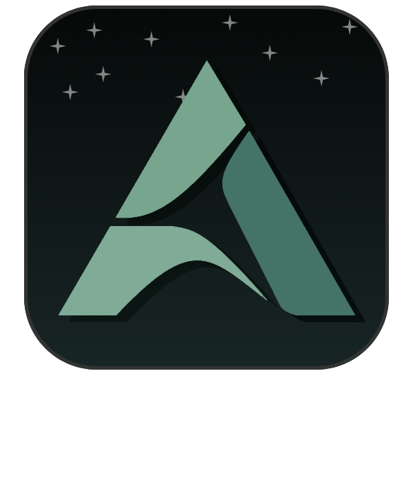

  

  
  
  

  <strong>An experimental static recompiled version of "Pokémon Legends: Arceus," the landmark first game in the Pokémon Legends series.</strong> 
  Aevora is not limited to performing static recompilation via the Aevora Recompiler, and it also serves as a launcher that provides quality-of-life improvements and graphics enhancements specifically tailored for PLA.

  <a href="#Status">Status</a> |
  <a href="#Implemented features">Implemented features</a> |
  <a href="#License">License</a>

> [!IMPORTANT]
> In the expected setup, the user will need to provide the base game's NSP file and corresponding update files separately. The user will also need to provide the key and any necessary firmware, which are not included with Aevora. 
> Furthermore, <strong>we do not condone the use of pirated sources on the internet to obtain these files. Please dump and acquire them from your own Switch.</strong>

## Status

Currently, Aevora can recompile PLA with Static AoT, achieving an average of 20-30 FPS. Only the CPU is currently statically recompiled; other components such as GPU, memory, and sound rely on Suyu emulation.

Currently, it has become clear that the Suyu recompiler's code execution method is quite inefficient, so we are attempting to fix it. Additionally, we have improved usability by implementing ImGui.

## Implemented features

- Native CPU processing in Static AoT recompiler
- An implementation of ImGUI, useful for debugging and quick configuration changes

## Planned Features

These planned features are not guaranteed to be implemented, and may change depending on the circumstances, potentially increasing or decreasing in the number of features

- Remove the GUI associated with Suyu and provide GUIs for the Aevora launcher and Aevora Recompiler
- Ultrawide support
- Native 4K and WQHD support, and no Dynamic resolution
- 60FPS Mode
- Implementation of anti-aging (TAA, FXAA, MSAA)
- Increased shadow resolution and distance
- Increased LoD and draw distance
- Enhanced ambient occlusion
- 16x anisotropic filtering and increased filtering distance
- Reducing stutter that occurs during shader compilation
- Native controller and keyboard support

## Releases and Versioning

When releases are available, users should choose a released version. Development builds are intended for developers and are not recommended for general use.

Release versions use **`vX.Y.Z`**. Development versions use **`vX.Y.Z-devN`**, where `N` identifies the number of development commits for that version. This keeps development progress visible without increasing the release version for every commit.

| Component | Meaning                                                                     |
| --------- | --------------------------------------------------------------------------- |
| `X`     | Large project milestones. Reaching`1` marks the first stable release.     |
| `Y`     | Major feature additions and development milestones toward a stable release. |
| `Z`     | Recompiler adjustments, fixes, and other bug fixes.                         |
| `devN`  | The development commit count for the version currently being worked on.     |

For example, `v0.1.0-dev7` denotes a development build for version `v0.1.0`. The corresponding release is named `v0.1.0`, without the development suffix. `v1.0.0` marks the first stable release.

## About Aevora Recompiler

Aevora Recompiler is an improved version of the Suyu Recompiler, specifically designed to make the necessary changes for statically recompiling Pokémon Legends: Arceus. It does not support recompiling any games other than Pokémon Legends: Arceus, and <strong>Aevora Recompiler assumes no responsibility for any compatibility issues or data loss that may occur.</strong>

For other games, consider [Suyu](https://github.com/suyu-emu/suyu-main) or [Drippu](https://github.com/suyu-emu/drippu). Compatibility must be evaluated per game.

Static AOT still relies on the runtime for system services, memory, audio, input, and GPU; GPU macro JIT and shader compilation remain runtime generation.

## Development Approach

Aevora uses AI-assisted coding, including "vibe coding." The goal is to keep the code understandable and maintainable by humans, with human review and hands-on testing guiding development. Generated code and successful compilation alone are not treated as proof that the game works correctly. Furthermore, for README.md, I had AI complete the incomplete text I had written, and then I rewrote it myself, removing unnecessary parts and making it easier to read.

Bug reports, questions, and feature requests are welcome. Useful reports include the build version, game update version, steps to reproduce the problem, and relevant logs.

## Project policies and support

Aevora is a personal project. It is not run for financial gain or recognition.

There will be no Patreon, Ko-fi, or other fundraising campaign, and the project does not accept donations or other monetary support.

## License

Aevora is Suyu-derived software and original code contributions are licensed under the **GNU General Public License, version 3 or later (`GPL-3.0-or-later`)**. See [LICENSE.txt](LICENSE.txt) for the full license text.

Existing source files, third-party dependencies, and assets retain their respective copyright notices and license terms. See individual file headers, [LICENSES/](LICENSES/), and [.reuse/dep5](.reuse/dep5) for the retained notices.

When distributing Aevora binaries covered by the GPL, provide access to the corresponding source code, including the modifications and build scripts required by the license.

The project's decision not to accept financial support is a project policy and does not impose additional restrictions on the software license.

This license does not grant rights to Pokemon Legends: Arceus game code or assets, Nintendo firmware, or keys supplied by users. Recompiling a game does not place its code or assets under this license.

## Documentation and Upstream Attribution

- [Work plan](docs/Aevora/WORK_PLAN.md), [Changelog](CHANGELOG.md), [Old history](docs/Aevora/OLD_HISTORY.md), and [Codebase index](docs/Aevora/CODEBASE_INDEX.md).
- Build instructions (`BUILD.md`) are not written yet.
- [Aevora documentation](docs/Aevora/): project-specific documentation.
- [Archived Suyu documentation](docs/Suyu/): upstream documentation retained for reference.
- [Upstream provenance](docs/Suyu/_main-folder/PROVENANCE.md): the original Suyu lineage record.
- [Upstream license](docs/Suyu/_main-folder/LICENSE.txt) and [license notices](LICENSES/).

The original upstream provenance document describes Suyu's history; it is retained as a reference rather than rewritten as a history of Aevora. Upstream copyright and license notices are preserved.
